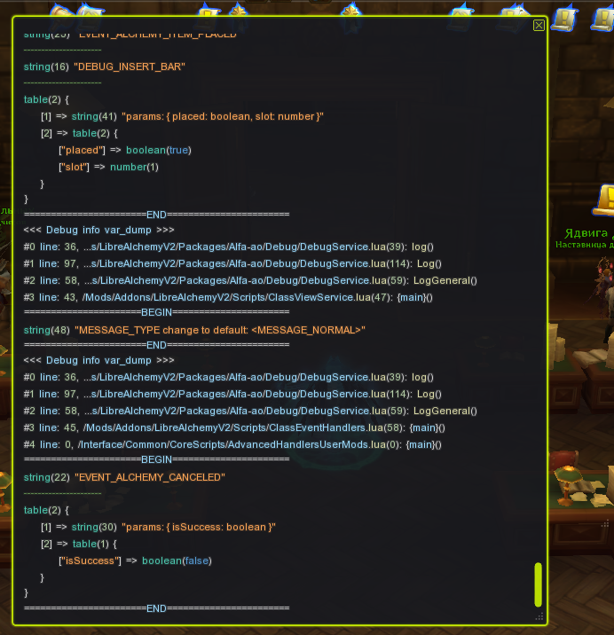

# Console

Консольное окно для вывода любой информации.

<p align="center">
  
</p>

Вызвать консоль
```
/console.log
```

## Описание

- Содержит следующие библиотеки:
    - [SyntaxHighlighter](https://github.com/Alfa-ao/SyntaxHighlighter) - Токенизатор. Подсветка текста.
    - [var_dump](https://github.com/Alfa-ao/var_dump) - Дамб любой информации.
- Консоль прекрасно работает в сочетании с установленной библиотекой [DebugService](https://github.com/Alfa-ao/DebugService) на стороне `аддона`. Т.е. ничего не надо настраивать в ручную.
- Реализуются три пользовательских событий.
    - `CONSOLE_USERADDON_SEND_PING` - Консоль сообщает о готовности.
    - `CONSOLE_USERADDON_DISABLE` - Консоль прекращает свою активность.
    - `CONSOLE_USERADDON_SEND_DATA` - Событие для отправки данных.

## Примеры

Реализация без `DebugService`. API отправка данных:

```lua
common.SendEvent( "CONSOLE_USERADDON_SEND_DATA", {
    data = mainForm, -- В консоль отправляется объект. Можно что угодно присвоить для data
    highlight = true, -- Подсветка
    var_dump = true -- Отладка. Если data ~= string, то всегда true автоматически
} )
```

В ином случае (с сервисом):

```lua
log( mainForm ) -- где угодно
```
